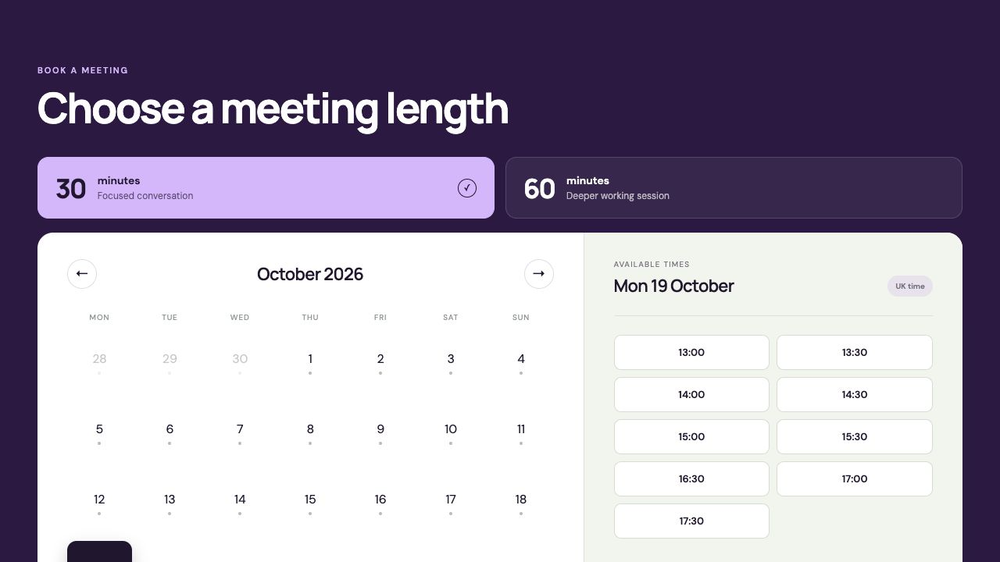

# Personal Booking Calendar

A self-hosted booking page that checks multiple calendars, creates a video meeting, sends calendar invitations, and gives attendees private reschedule and cancellation links.

One person can run it without an admin dashboard. Settings live in one ignored JSON file, credentials stay in Cloudflare secrets, and the public repository contains only safe example values.

[](https://booking.taylorwilliams.app/)

## Why this exists

Most booking services charge a monthly fee. This project covers the simpler case: one person needs a booking page, calendar checks, video links and private rescheduling.

The app itself can cost £0 to run within each provider’s free allowances:

- [Cloudflare Workers](https://developers.cloudflare.com/workers/platform/pricing/) hosts the app and [Cloudflare D1](https://developers.cloudflare.com/d1/platform/pricing/) stores bookings. Their free plans are ample for a small personal calendar.
- A personal Google account can create Meet links. [Google’s free meeting limits](https://support.google.com/meet/answer/7317473?hl=en-uk) allow one-to-one calls for up to 24 hours and group calls with three or more people for up to 60 minutes, so the included 30- and 60-minute meeting types fit within the free service.
- Microsoft Graph and Apple CalDAV check the calendars you already use. Microsoft also sends the calendar invitation.
- Resend owner notifications are optional. The booking and calendar invitation still work without them.

You still need the relevant provider accounts, and a custom domain has its own registration cost. Free-service limits and terms can change, so check them before deploying a high-traffic calendar.

## What it does

- 30- and 60-minute booking links, including fixed `/30` and `/60` routes
- browser-local time display with scheduling rules in your configured timezone
- Microsoft Outlook/Hotmail calendar availability and invitations
- Google Meet creation through Google Calendar
- optional Apple/iCloud availability across selected calendars
- private cancellation and rescheduling links
- Cloudflare Turnstile bot protection and D1 storage
- optional Resend notifications to the calendar owner
- configurable working hours, notice period, rates, branding and social preview

## Prerequisites

The complete booking flow uses Cloudflare, a personal Microsoft account and a Google account. Apple Calendar and Resend are optional. You do not need Microsoft 365 Business, Teams for work, Google Workspace or paid hosting.

### Required accounts and services

| What you need | What to set up | Why it is needed |
| --- | --- | --- |
| [Cloudflare account](https://dash.cloudflare.com/sign-up) | Workers, one D1 database and one Turnstile widget. Authenticate Wrangler on the computer you deploy from. | Runs the app, stores bookings and blocks automated booking attempts. These services have free allowances suitable for a small personal calendar. |
| Public HTTPS address | Use a Cloudflare `workers.dev` address or a custom domain you control. Decide this before creating the OAuth apps because their callback URLs must match it exactly. | Gives the app a stable address for visitors, OAuth callbacks and Turnstile. A custom domain is optional and may have a registration cost. |
| Personal Microsoft account | The Outlook.com, Hotmail or Live account whose calendar will receive bookings. Keep its exact email address for `MICROSOFT_EXPECTED_ACCOUNT`. | Checks availability, creates the main calendar event and sends the invitation to the attendee. |
| [Microsoft Entra app registration](https://learn.microsoft.com/en-us/entra/identity-platform/quickstart-register-app) | Access to a Microsoft Entra tenant where you can register an app. The registration must allow personal Microsoft accounts, use a Web redirect URI, have a client secret, and include delegated `User.Read` and `Calendars.ReadWrite` permissions. | Lets this self-hosted app connect securely to the personal Microsoft account. A personal account alone may not have an Entra tenant, so create a free tenant first if the App registrations page is unavailable. |
| Personal Google account | A [Google Cloud project and OAuth client](https://developers.google.com/workspace/guides/create-credentials#oauth-client-id). Enable the Google Calendar API, configure the OAuth consent screen, create a Web application client and add your Google account as a test user while the app is in testing. | Creates the Google Calendar event and free Google Meet link. The app requests `openid`, `email` and `calendar.events`; Google Workspace is not required. |

The Microsoft registration must accept personal accounts because the app uses Microsoft’s `consumers` sign-in endpoint. Choose **Personal Microsoft accounts only**, or another supported account type that explicitly includes personal Microsoft accounts.

Google OAuth apps left in **Testing** issue refresh tokens that expire after seven days when these Calendar permissions are used. Move the app to **Production** before relying on unattended bookings. A personal, single-user installation can still show Google’s unverified-app warning; only continue with an OAuth app that you created and control.

Register these exact Web callback paths on the public HTTPS address you choose:

- Google: `/api/integrations/google/callback`
- Microsoft: `/api/integrations/microsoft/callback`

### Optional accounts and services

| What you need | When you need it |
| --- | --- |
| Apple Account with iCloud Calendar | Only if Apple calendars should also block unavailable times. The account must use two-factor authentication so you can create an [app-specific password](https://support.apple.com/en-gb/102654). You will also need the exact display name of every Apple calendar to check. Apple is read-only in this app. |
| Resend account | Only if you want a separate email when someone books. Create an API key and verify the sending domain or address. Microsoft still sends the attendee’s calendar invitation. |
| Custom domain | Only if you do not want to use the free Cloudflare hostname. The domain does not have to be bought from Cloudflare, but its DNS and HTTPS must be working before OAuth is connected. |

### Local tools

- Git
- Node.js 22.13.0 or later, which includes npm
- A terminal in which you can authenticate Cloudflare Wrangler

Before deployment, you will create two private local values: a 32-byte `CALENDAR_TOKEN_KEY` for encrypting OAuth refresh tokens and a long `CALENDAR_SETUP_KEY` for protecting the one-time calendar connection pages. The [deployment guide](docs/DEPLOYMENT.md) lists every setting and secret and explains where each one goes.

## Quick start

Once the prerequisites above are ready:

```sh
npm ci
npm run setup
npm run dev
```

`npm run setup` asks a few plain-English questions and creates two private files:

- `.booking-config.json` — the reusable settings for your booking page
- `.dev.vars` — the local runtime copy

Both files are ignored by Git. A safe example is available in [`booking.config.example.json`](booking.config.example.json).

## Deploying

The app runs on Cloudflare Workers with D1. Copy `wrangler.example.jsonc` to `wrangler.jsonc`, add your own account/database/domain details, then follow [the deployment guide](docs/DEPLOYMENT.md).

The short version is:

```sh
npm run config:push
npm run db:migrate:cloudflare
npm run deploy:cloudflare
```

Never put OAuth secrets, app-specific passwords, encryption keys or API keys into the JSON config or `wrangler.jsonc`. Add them as encrypted Worker secrets.

## Configuration

These are the main settings:

| Setting | Purpose |
| --- | --- |
| `name`, `firstName` | Names shown on the public and management pages |
| `publicOrigin` | The exact HTTPS URL of the deployed site |
| `timezone`, `timezoneLabel` | Scheduling timezone and visitor-facing label |
| `workingDays`, `workingHours` | When bookings may start |
| `minimumNoticeMinutes` | How soon someone may book |
| `maximumAdvanceDays` | How far ahead the calendar opens |
| `meetingDurations` | Available lengths and labels |
| `appleCalendarNames` | iCloud calendars used for availability only |
| `rates` | Optional informational rates shown with `?rates=true` |
| `branding` | Local paths for the avatar, social image and favicon |

Put personal artwork under `public/user/`; that folder is ignored. Point your private configuration to paths such as `/user/avatar.png`. The repository ships with a neutral placeholder.

## Security

The public availability API returns timestamps only. Calendar titles and event details stay server-side. OAuth refresh tokens are encrypted before D1 storage, booking-management tokens are stored as hashes, calendar failures fail closed, and booking writes require same-origin requests plus Turnstile.

Run the complete local verification before deploying:

```sh
npm run check
npm audit --omit=dev
```

See [SECURITY.md](SECURITY.md) for deployment responsibilities and private vulnerability reporting.

Product copy follows the [clear operational language guide](docs/CONTENT_STYLE.md).

## Licence

MIT — see [LICENSE](LICENSE).
